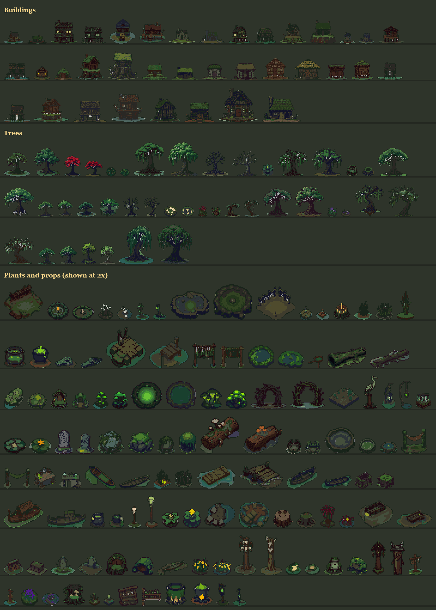

# Murky Swamp

Stilt huts, twisted trees, reeds, lily pads, mushrooms and witchy props for a bog.

200 transparent PNG files with variants: 37 buildings, 42 trees, 121 plants and props. Top-down RPG scale (32 px tiles). Buildings are drawn straight from the front, so they line up along a street. The whole pack shares one palette (palette.png, 150 colours).

## Animations
66 looping animations in `assets/animations/`: 8 frames in a row, each frame the size of the still picture (floating boats: 2 px wider, 1 px taller). Preview: animations.gif. Each strip has a Godot 4 SpriteFrames file beside it (`<name>_anim.tres`, looping, the same pace as the preview): put the folder in a Godot project and give it to an AnimatedSprite2D.

## 2x detail versions
The 53 small things (props and plants up to 32 px wide) are also in `detail_2x/`, drawn at twice the width from the same source picture, so small details (fruit, eyes, labels, flames) keep their shape. Same folders and file names as in `assets/`, same palette. Use them at 2x in a game whose camera shows 64 px tiles, or scaled to 0.5 next to the 1x art when you want the detail (the pixels are then finer than the rest). Preview: preview_detail_2x.png.

## How it was made
AI-assisted: drawn with an open image model (FLUX.1-schnell, Apache-2.0) on our own computer, then turned into pixel art in code (cut out, shrunk to the pixel grid, outlined, shared palette) and checked by hand.

## Licence
You may use these assets in unlimited commercial and non-commercial games and projects, and edit them as you like. Credit is not required, but always appreciated. You may not resell, share or redistribute the assets themselves (edited or not), alone or as part of another asset pack, and you may not use them to train AI models.

